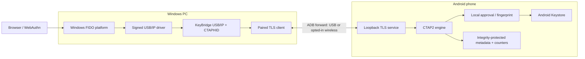
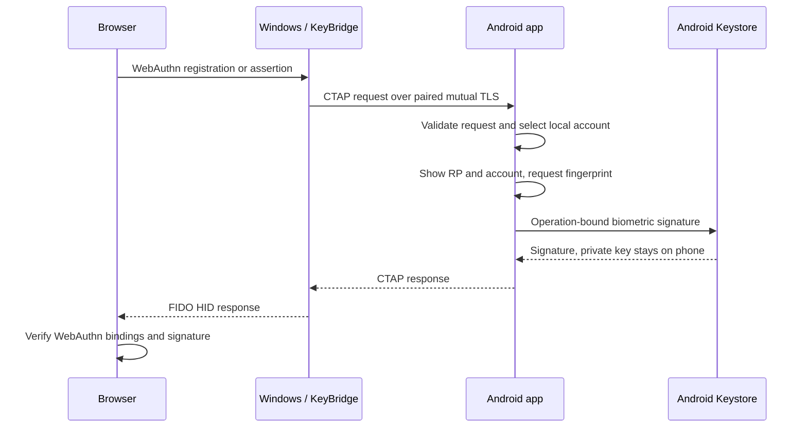

# KeyBridge

Use an Android phone as a FIDO2 security key on Windows. Credential keys stay in Android Keystore; the Windows companion carries authentication requests to the phone over an authenticated ADB tunnel. Each credential operation requires local fingerprint approval.

[](https://github.com/devz-on/KeyBridge/actions/workflows/build.yml)
[](LICENSE)
[](https://github.com/sponsors/devz-on)

[Downloads](https://github.com/devz-on/KeyBridge/releases) · [Setup guide](docs/installation.md) · [Contributing](CONTRIBUTING.md) · [Security](SECURITY.md)

## Status

**0.1.2 is a development preview.** Real registration and authentication have passed through Chrome, Windows FIDO HID, USB/IP, paired ADB and a physical Android phone. The browser verified the returned ES256 signature. ADB connection loss also removed the virtual key.

Those results cover the recorded development configuration, not every phone, browser or Windows build. KeyBridge is not FIDO certified or independently security audited. Use test credentials and keep another way to access your accounts. See the [verification record](docs/verification.md) for tested and outstanding cases.

## Downloads

| Package | Purpose |
| --- | --- |
| [Windows setup](https://github.com/devz-on/KeyBridge/releases/download/v0.1.2/KeyBridge-0.1.2-Setup-x64.exe) | Companion, private ADB tools, .NET runtime, offline test page, phone APK and original signed USB/IP driver installer |
| [Android APK](https://github.com/devz-on/KeyBridge/releases/download/v0.1.2/KeyBridge-0.1.2-android-release.apk) | Signed, non-debuggable release APK; also included in Windows setup |
| [SHA-256 checksums](https://github.com/devz-on/KeyBridge/releases/download/v0.1.2/SHA256SUMS.txt) | Integrity checks for the published downloads |

The Android release APK is signed with a dedicated KeyBridge release key, with debugging disabled. Its certificate SHA-256 is `A95FBB8CBD9CF0D2ABB33C8842BA1B1C516DD3D9F3F9F8C31D1CF19D4B4D3649`. The Windows setup itself is currently unsigned; the included third-party driver retains its upstream signatures. KeyBridge remains a development preview.

## Requirements

| Component | Requirement |
| --- | --- |
| PC | Windows 11 on x64 hardware; the kernel driver does not support ARM emulation |
| Phone | Android 11 / API 30 or later, a secure screen lock and a strong biometric |
| Connection | USB data cable and authorized debugging; already-authorized wireless debugging is an explicit alternative |
| Windows driver | Signed usbip-win2 client/VHCI driver; administrator approval is required to install it |
| Browser | A browser using the Windows WebAuthn security-key interface; Chrome/localhost is the recorded tested path |

Running the release packages does not require Android Studio, Java, Node.js or a separate .NET installation. There is no browser extension, cloud service, root requirement or bootloader change.

## Getting started

1. Run the Windows setup. It installs the companion and tools first. On **Finish**, the selected driver step opens its own installer if needed; the KeyBridge wizard hides while that installer runs. Desktop shortcuts are selected by default. A driver restart request is left for you to handle manually.
2. Enable debugging on the phone and authorize the intended PC. Select the phone in **Connection → Install phone app**, or install the downloaded APK. Open KeyBridge on Android and tap **Start bridge**.
3. In Windows, select the phone and **Connect**. On first pairing, compare every group of the 64-character fingerprint on both devices and approve the matching request locally.
4. Select **Enable security key**. Signed-driver attachment is enabled by default. Runtime signature checks and Windows HID detection still run. The **Checks** tab shows ADB, driver/client, phone, pairing, biometric readiness and virtual-key status.
5. Register a diagnostic passkey, then authenticate. Complete the Windows security-key flow and approve the phone request. Windows may perform a credential preflight, so a single browser action can require two fresh approvals.

For the included offline test, run `Run-WebAuthn-Diagnostic.cmd` from the installed directory and open `http://localhost:8787` in Chrome. The page checks the challenge, origin, RP hash, credential/user identity, UP/UV flags, counter policy and ES256 signature. No simulated authenticator is used.

**Updating Android:** use `adb install -r` with the official release APK. It includes a signing lineage from the original maintainer development identity to the release key. This supports an in-place migration on supported Android versions; the first physical migration has not yet been checked. Uninstalling or resetting the app destroys its Keystore credentials. Unrelated debug builds have different signing identities and cannot use this migration.

## How it works



The PC exports one virtual FIDO HID device on loopback. A USB/IP client imports that device into Windows. CTAPHID requests are forwarded through an ADB-created tunnel to the Android service. Both endpoints authenticate with pinned certificates after explicit pairing.



Credential keys are non-exportable P-256 keys with per-use biometric authorization. Windows owns a separate CNG **transport** identity; that identity cannot sign a FIDO credential. Android metadata has Keystore-backed integrity protection, and signature counters are reserved durably before signing. Canceled operations can leave counter gaps.

Pairing does not authorize unattended signing. A closed tunnel cancels pending work and removes the virtual device. The phone displays the RP supplied by the client; it does not independently inspect the browser origin. The browser/platform and the paired desktop remain part of the trust boundary.

## About the USB/IP driver

KeyBridge supplies user-space USB/IP and CTAPHID code. It does not implement a new kernel driver. Windows needs the **client/VHCI** role supplied by [usbip-win2](https://github.com/vadimgrn/usbip-win2). `usbipd-win` is a different product and is not a replacement for that client role.

Setup embeds the unchanged official **usbip-win2 0.9.8.1 x64** installer. Its SHA-256, Authenticode publisher, kernel signatures and catalog membership were checked; the [component report](docs/driver-component-verification.md) records those checks. The build script rejects a changed hash or unexpected publisher. Setup checks the payload hash again before launching it.

Driver installation happens after the companion is installed and requires the driver's normal elevated wizard. USB devices may briefly reconnect. Automatic reboot is disabled. If installation is canceled, the companion stays installed and **Checks** shows the missing dependency. KeyBridge never disables Secure Boot, signature enforcement, memory integrity or antivirus protections.

The driver is shared system software. Removing KeyBridge does not automatically remove it or disturb other USB/IP devices. A phone may also need its manufacturer's signed USB interface driver if Windows cannot detect it; no generic unsigned phone driver is installed. See [installer details](docs/installer.md) and [troubleshooting](docs/troubleshooting.md).

## Supported protocol profile

| Supported | Outside this release |
| --- | --- |
| CTAP2.0 / `FIDO_2_0` | CTAP1/U2F and ClientPIN |
| ES256 / P-256 | CTAP2.1 extensions and remote credential management |
| Discoverable credentials and local account selection | Credential export, cloud sync and recovery |
| Built-in user verification and `none` attestation | Vendor attestation and FIDO certification |
| USB/IP 1.1.1 and CTAPHID fragmentation/cancellation | General-purpose USB forwarding |

The development USB identity is `1209:0001`. A production release needs an appropriate assigned VID/PID, conformance testing and an independent security review.

## Build from source

Development prerequisites are .NET SDK 10, JDK 21, Android SDK platform/build-tools 36 and Node.js 22+ for the browser helper tests. The pinned Gradle wrapper downloads Gradle 8.13 and verifies its distribution hash. Install official Inno Setup 6.7.3 to build the Windows setup executable.

```powershell
git clone https://github.com/devz-on/KeyBridge.git
cd KeyBridge
$env:JAVA_HOME = 'C:\path\to\jdk-21'
$env:ANDROID_HOME = 'C:\path\to\Android\Sdk'
.\scripts\Build.ps1
.\scripts\Test.ps1
.\scripts\Build-Installer.ps1
```

`Package.ps1` creates the portable Windows package and Android development outputs. For distribution, configure a protected signing identity and run `Package.ps1 -SignAndroid`; see [release signing](docs/release-signing.md). `Build-Installer.ps1` requires the signed, non-debuggable release APK, verifies the official prerequisites and writes setup under `artifacts/releases/0.1.2/`. Pass `-IsccPath` for a nonstandard compiler location or `-SkipPackage` after packaging current binaries. CI compiles both Android variants without access to the private release key.

On Linux, the platform-independent Android module can be built with JDK 21 and an Android SDK:

```sh
cd android
chmod +x gradlew
./gradlew :core:test :app:assembleDebug --no-daemon
```

### Repository layout

```text
KeyBridge/
├── android/
│   ├── app/                 Compose UI, Keystore, biometrics, storage and service
│   └── core/                CTAP, CBOR, framing and navigation regression tests
├── windows/
│   ├── KeyBridge.App/       WPF companion and tray
│   ├── KeyBridge.Core/      ADB, TLS, pairing, readiness and lifecycle
│   ├── KeyBridge.Usb/       USB/IP, descriptors and CTAPHID
│   └── KeyBridge.Tool/      Physical-phone diagnostics and public-key verification
├── tests/
│   ├── KeyBridge.Core.Tests/
│   ├── KeyBridge.Usb.Tests/
│   └── webauthn/            Offline browser diagnostic and strict helper tests
├── protocol/               Versioned transport contract
├── shared/                 Cross-language test vectors
├── packaging/              Inno Setup and portable-install sources
├── scripts/                Build, test, package and icon generation
├── assets/                 Shared icon and documentation media
└── docs/                   Architecture, setup, threat model and verification
```

Windows and Android are kept in one repository so transport changes and shared vectors can be reviewed together. Generated outputs, local SDK configuration, signing stores and device data are excluded from Git. For isolated contribution work, `git worktree add ../KeyBridge-fix -b fix/short-description` creates a second checkout without copying credentials or build outputs.

## Tests and verification

The test suites cover real loopback USB/IP/TLS exchanges, malformed frames, pairing/pinning, cancellation, counters, CTAP/CBOR, signature verification and Android navigation history. Android instrumentation tests exercise actual Keystore policies. Hardware tests and browser ceremonies are recorded separately from software tests.

Read [verification.md](docs/verification.md) before treating a passed build as hardware acceptance. Fresh installations, additional relying parties/browsers, suspend/resume, physical unplug during approval and long-running behavior still need wider testing. Device instrumentation is opt-in; use a dedicated test phone rather than a vault containing credentials you rely on.

## Contributing and support

Bug reports, documentation fixes, accessibility work and compatibility testing are welcome. Start with [CONTRIBUTING.md](CONTRIBUTING.md), open a focused [issue](https://github.com/devz-on/KeyBridge/issues), or send a pull request with the relevant checks and hardware context. Use synthetic accounts in reproductions and redact device identifiers and authentication data.

Report vulnerabilities through [private security reporting](https://github.com/devz-on/KeyBridge/security/advisories/new), not public issues. See [SECURITY.md](SECURITY.md).

If you would like to support maintenance and device testing, [sponsor devz-on on GitHub](https://github.com/sponsors/devz-on). Sponsorship is optional and does not change the license or authentication behavior.

## License

KeyBridge is [MIT licensed](LICENSE). Bundled dependencies keep their own licenses and signatures; see [THIRD_PARTY_NOTICES.md](THIRD_PARTY_NOTICES.md). KeyBridge is an independent project and is not affiliated with Google, Microsoft or the FIDO Alliance.
