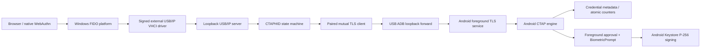

# Architecture

`KeyBridge.Usb` has no credential generation or signing code. It forwards complete CTAP commands through `ICtapTransport`. `PhoneClient` enforces explicit pairing, message limits, correlation and certificate pinning. `BridgeController` owns a user-session background component, not a privileged Windows service. The WPF companion and tray share that lifecycle.

WPF was selected over WinUI to produce a stable native Windows binary without another Windows App SDK bootstrap dependency. It uses vector device illustrations, rounded surfaces, theme resources and reduced-motion handling. It does not make USB drivers user-mode or remove administrator requirements for external driver installation.

The Android module contains a JVM-testable authenticator, a platform Keystore adapter, integrity-protected app-private SQLite metadata, an approval broker and a user-visible foreground service. Only this module can create credential keys, choose an account, grant biometric approval or sign. Software-generated test keys exist only in test assemblies/JVM test source.

Trust crosses three boundaries: browser/platform supplies RP ID and client-data hash; paired desktop supplies transport identity; Android supplies local user verification and key use. The phone does not independently verify browser origin and presents the supplied RP ID as such. Attestation is `none`, with an anonymized zero AAGUID, not a hardware manufacturer's identity.

On USB loss, the controller stops USB/IP, cancels requests and removes its own ADB forward. Phone socket closure cancels pending approval. Per-use Keystore authentication prevents a desktop protocol message from enabling unattended credential signing. The virtual server being online is separate from driver attachment, HID enumeration and successful browser authentication.
